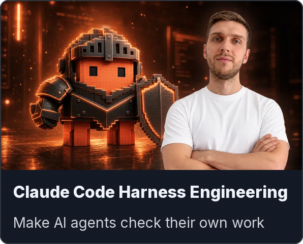
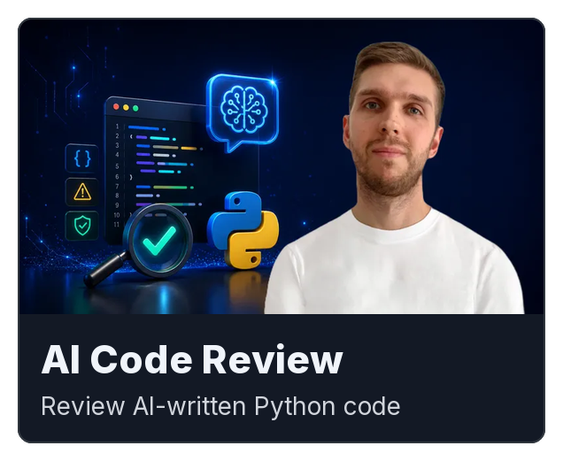
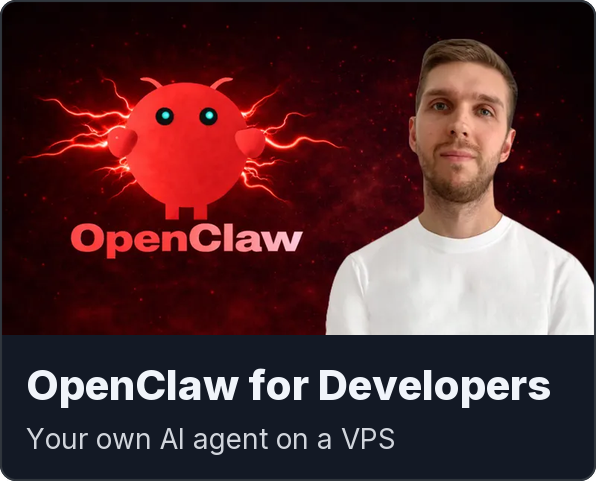
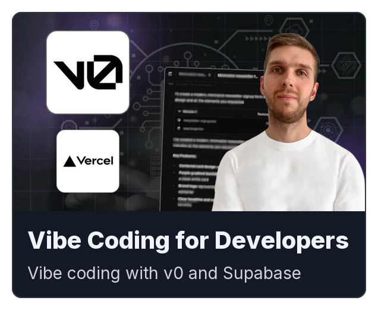
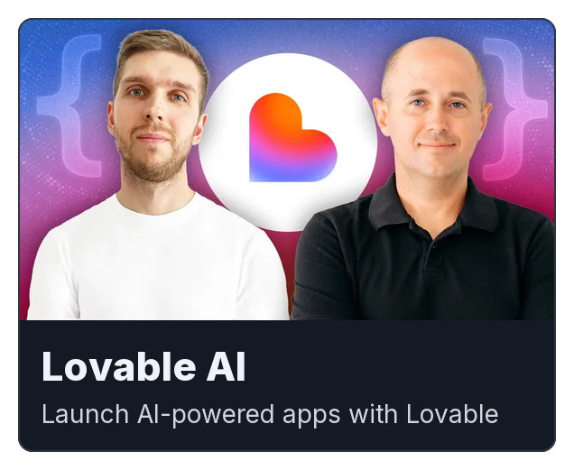
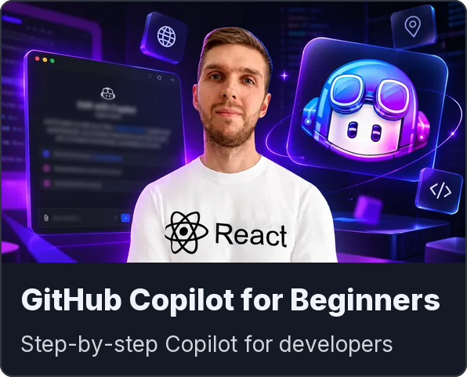
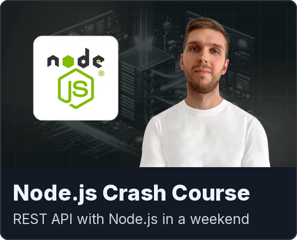
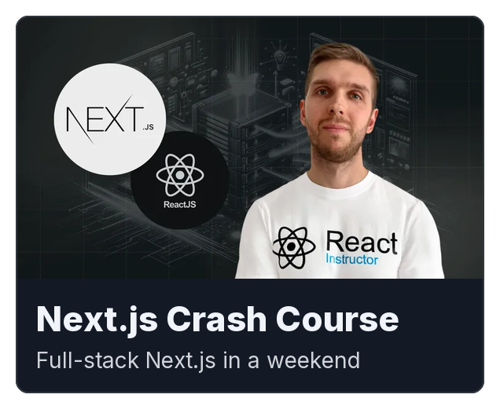
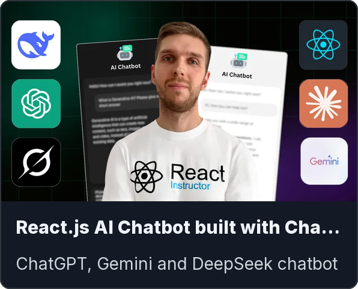
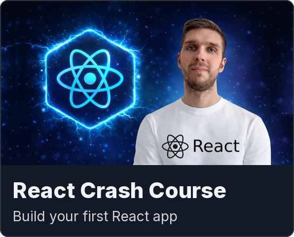

  

## About Me

👨‍💻 I am a **Senior Frontend & Full-Stack Engineer** with **11+ years** of experience building web applications in React, Next.js, TypeScript and Node.js. For the past 4 years I have led the frontend at Doccle, a document platform used by **2.5M people**.

🧭 **Frontend leadership:** I joined Doccle as the only frontend engineer and led the move of the whole product from Grails and Angular to Next.js while shipping core features with backend engineers from several teams. At DasLab, as Technical Frontend Lead, I grew the team to **5 engineers** and set up code review, testing and releases.

🏗️ **Architecture:** At Doccle I own the frontend architecture of the Nx monorepo and built its design system of **100+** accessible components, moved every app onto it and raised test coverage to **70–80%**. At Webjet I led the migration from AngularJS to Vue. At Blackbell I migrated old functionality from Backbone to Vue.

🎯 **Features end to end:** I shape scope with product owners and propose simpler solutions. At Doccle I built a complex payment widget that began the migration: prototype in **2 mo**, MVP in **6 mo**. It now runs in many apps and pages. At DasLab I chose the stack for 2 apps from scratch (patient booking, lab admin), behind **600K+** test results.

🤖 **AI workflow:** At Doccle my AI guidelines keep code consistent team-wide, backend included, and an agent takes a task from Jira to a merge request, which speeds up delivery and eases code review.

🎓 **Teaching:** I have taught **235,000+ students** in **25+ courses** on AI agents and web development on Udemy and Coursera, rated **4.4+** on average.

### Open to long-term remote contract

📩 Email: [jobs@dvasyliev.com](mailto:jobs@dvasyliev.com)  
📄 Download my CV: [dmytro-vasyliev-senior-full-stack-engineer.pdf](https://www.dvasyliev.com/dmytro-vasyliev-senior-full-stack-engineer.pdf)

### Top Skills

<!-- COURSES:START -->
## My Educational Courses

I teach developers what I use in production: practical, project-based courses on AI coding tools, Agentic AI, Vibe Coding and modern full-stack technologies. Every course builds on projects I ship and workflows I test first. Students learn what holds up in real work, from new framework releases to AI coding tools.

👨‍🎓 Taught **235,000+ students** across Udemy and Coursera, with a **4.4+ average rating**. 
📚 Created **25+ courses** across AI coding, frontend, full-stack and modern developer tools.

#### AI Coding Courses

  
  
  
  
  
  
  
  
  
  

#### Web Development Courses

  
  
  
  

[See more courses →](https://www.dvasyliev.com/courses)
<!-- COURSES:END -->
