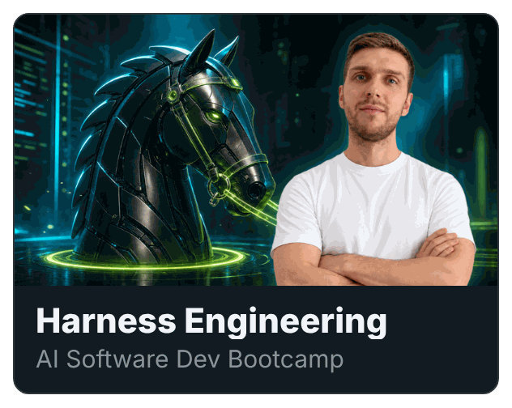
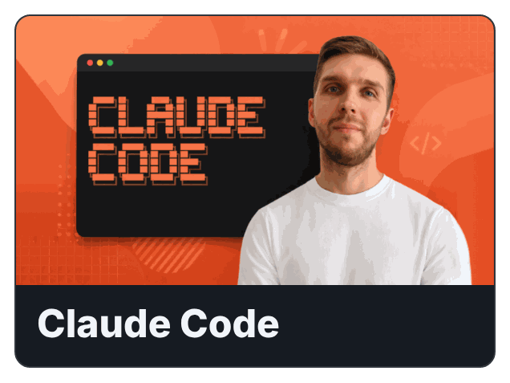
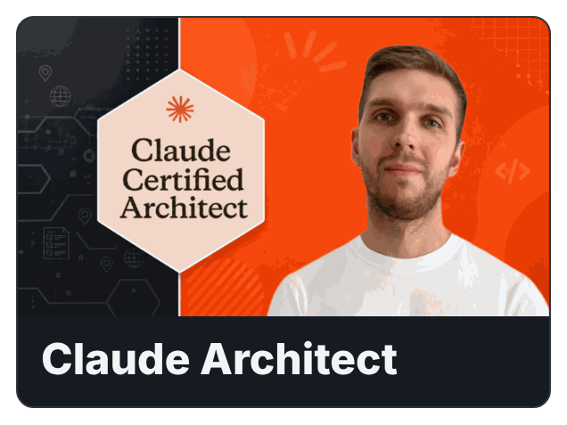
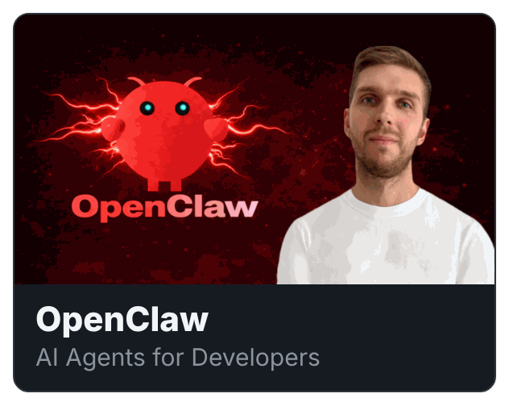
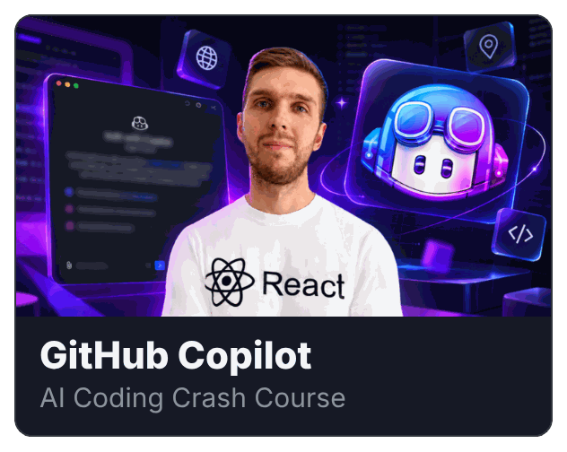
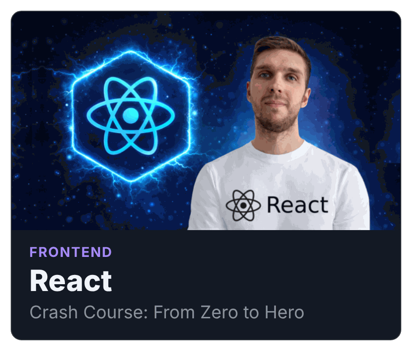
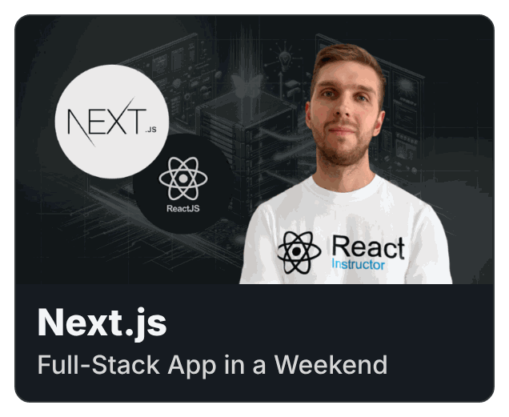

  

###  Hello there!

### About Me

👨‍💻 I'm a Senior Frontend Engineer with 11+ years in React, Next.js and TypeScript.

I work on established products that need new features and a cleaner codebase at the same time. I stay hands-on: I write the code myself, use AI tools every day and move old code to the new stack without stopping releases.

🟢 **Open to long-term remote contract work** as a **Senior Frontend Engineer** or **Frontend Lead** with companies in 🇺🇸 the US, 🇬🇧 the UK, 🇳🇱 the Netherlands, 🇧🇪 Belgium, 🇩🇪 Germany and 🇵🇱 Poland. 
📩 Send me a message about the product you're building or the old code that's slowing you down: **[jobs@dvasyliev.com](mailto:jobs@dvasyliev.com)**

### Where I have deep experience

🛠️ **Hands-On Feature Development** — Own features end to end on the new Next.js stack while the migration runs. 
🤖 **AI-Assisted Development** — Automate the development workflow with AI, from ticket to reviewed merge request. 
🔄 **Legacy Refactoring & Migrations** — Move a legacy Grails application to Next.js piece by piece, without freezing releases. 
🎨 **Design Systems** — Build a shared library of 90+ components used across several products. 
🧪 **Testing** — Cover each change with tests in Jest, Vitest and Cypress so nothing breaks.

### Tech Stack

### Teaching & Course Creation

I teach developers what I use in production: practical, project-based courses on AI coding tools, Agentic AI, Vibe Coding and modern full-stack technologies. Every course builds on projects I ship and workflows I test first. Students learn what holds up in real work, from new framework releases to AI coding tools.

👨‍🎓 Taught **235,000+ students** across Udemy and Coursera, with a **4.4+ average rating**. 
📚 Created **25+ courses** across AI coding, frontend, full-stack and modern developer tools.

#### Featured courses

  
  
  
  
  
  
  
  

<a href="https://www.dvasyliev.com/courses"><b>See all 25+ courses →</b></a>

### Let's work together

📩 Building a product or stuck with old code? Write to me and tell me about it.

