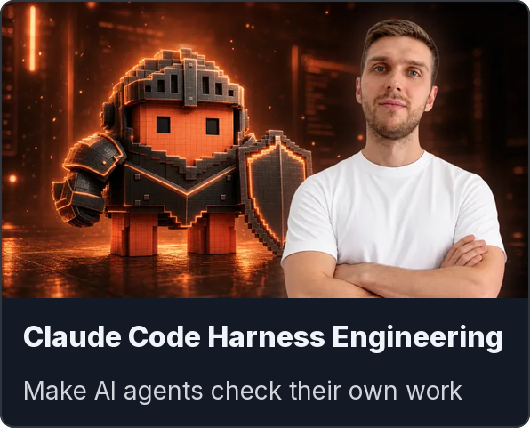
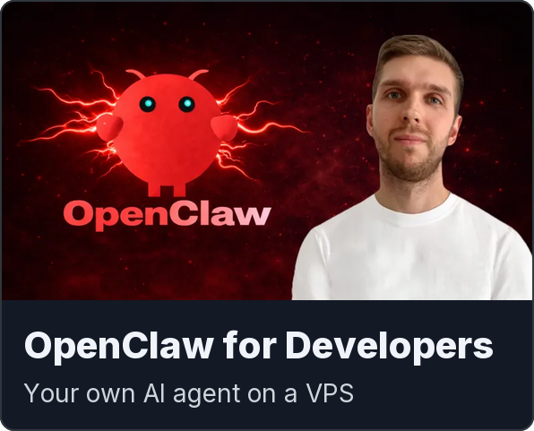
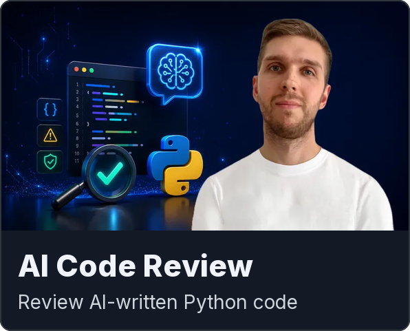
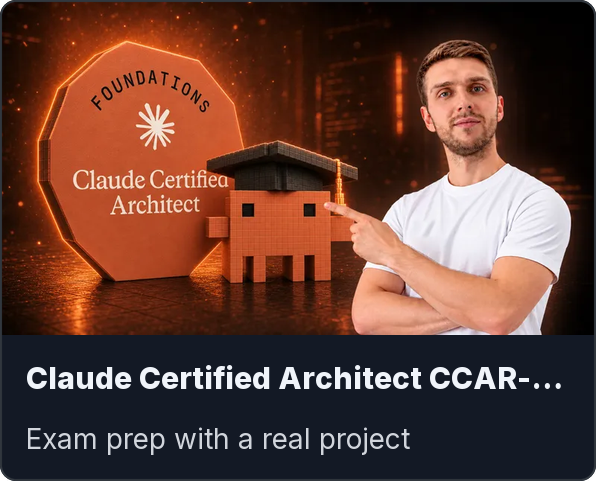
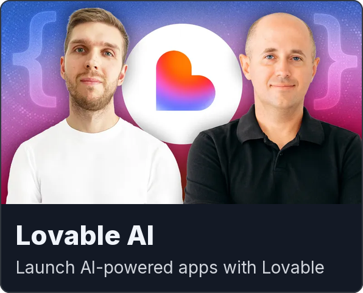
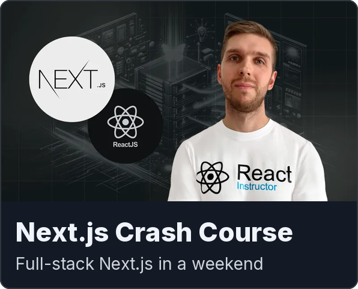
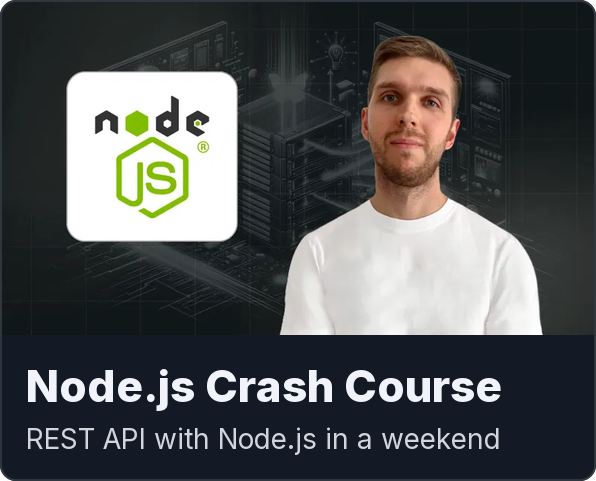

  

## About Me

👨‍💻 I am a **Senior Full-Stack Engineer** with **11+ years** of experience building web applications. For the past four years I have led the frontend at Doccle, a document platform used by **2.5M people** and integrated with **150+ companies**.

🤖 **AI & Agents:** I set up the team's AI development workflow on Claude Code: features ship faster, merge requests arrive cleaner, an agent handles the routine of finding and fixing review issues, and test coverage grew to **70–80%**.

🏗️ **Architecture & Leadership:** I set the technical direction and lead teams from scope to release. At Doccle I cut duplicated UI code several times over with a design system of **90+ components** and led the migration off the legacy stack. At DasLab I grew the frontend team to **5 engineers** and set up the process from scratch.

🎯 **Product focus:** I shape the scope with product owners and CTOs: propose simpler ways to build features and decide with them what to ship first. At Doccle I delivered a payment widget to **hundreds of thousands of users**. At DasLab I led the frontend architecture of a diagnostics platform behind **600K+ delivered test results**.

🎓 On Udemy and Coursera I have taught **235,000+ students** in **25+ courses**, with a **4.4+ average rating**.

### Open to long-term remote B2B contract

📩 Email: [jobs@dvasyliev.com](mailto:jobs@dvasyliev.com)  
📄 Download my CV: [dmytro-vasyliev-senior-full-stack-engineer.pdf](https://www.dvasyliev.com/dmytro-vasyliev-senior-full-stack-engineer.pdf)

### Top Skills

<!-- COURSES:START -->
## My Educational Courses

I teach developers what I use in production: practical, project-based courses on AI coding tools, Agentic AI, Vibe Coding and modern full-stack technologies. Every course builds on projects I ship and workflows I test first. Students learn what holds up in real work, from new framework releases to AI coding tools.

👨‍🎓 Taught **235,000+ students** across Udemy and Coursera, with a **4.4+ average rating**. 
📚 Created **25+ courses** across AI coding, frontend, full-stack and modern developer tools.

#### AI Coding Courses

  
  
  
  
  
  
  
  
  
  

#### Web Development Courses

  
  
  
  

[See more courses →](https://www.dvasyliev.com/courses)
<!-- COURSES:END -->
